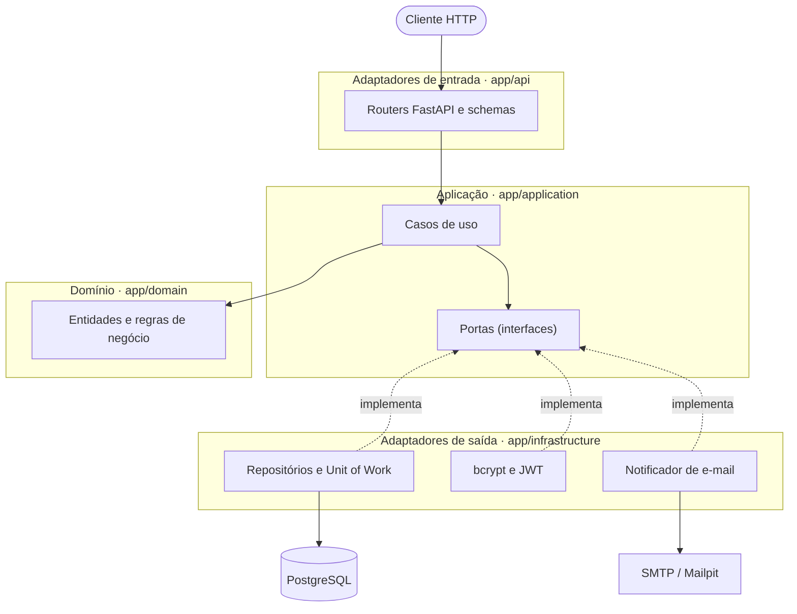
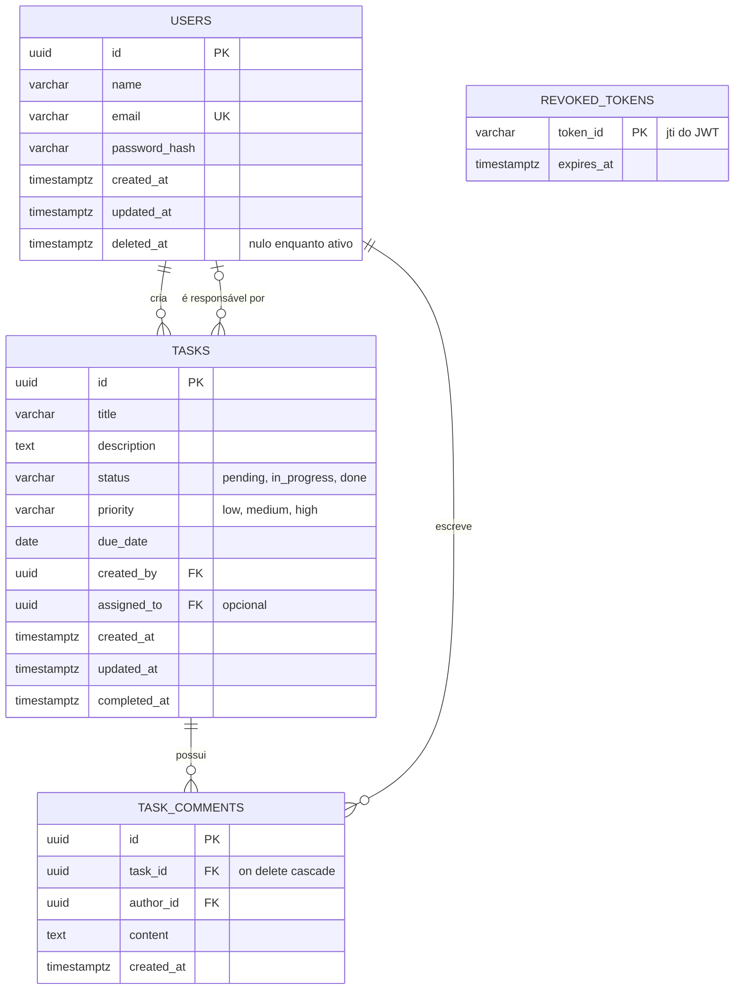
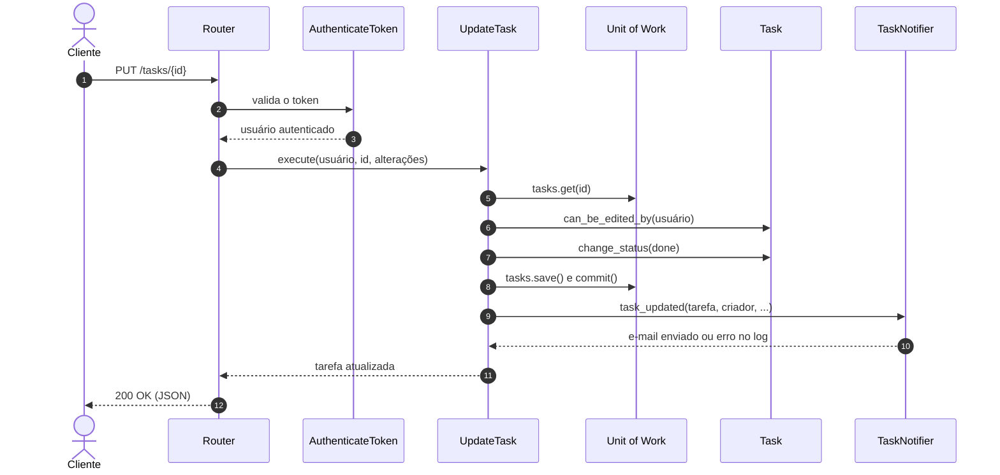

# API de Gestão de Tarefas Colaborativas

Documentação técnica do Trabalho T2 da atividade acadêmica **Engenharia de Software – Arquitetura
e Padrões** (Unisinos), prof. Guilherme Silva de Lacerda.

| | |
|---|---|
| Equipe | Paola _(sobrenome)_ e _(nome da colega)_ |
| Vídeo de demonstração | _(link do vídeo)_ |
| Especificação OpenAPI | [`docs/openapi.json`](docs/openapi.json), também servida em `/docs` com a API no ar |

## Sumário

1. [Visão Geral](#1-visão-geral)
2. [Decisões Arquiteturais](#2-decisões-arquiteturais)
3. [Modelagem de Dados](#3-modelagem-de-dados)
4. [Fluxo de Requisições](#4-fluxo-de-requisições)
5. [Configuração e Deploy](#5-configuração-e-deploy)
6. [Testes Automatizados](#6-testes-automatizados)
7. [Tratamento de erros, logs e segurança](#7-tratamento-de-erros-logs-e-segurança)
8. [Versionamento e equipe](#8-versionamento-e-equipe)

## 1. Visão Geral

### 1.1 Objetivo do sistema

API REST para que equipes criem, editem, atribuam e concluam tarefas. Cada tarefa tem título,
descrição, prioridade, prazo, um responsável e um status (`pending` → `in_progress` → `done`), e os
envolvidos são avisados por e-mail quando ela é atribuída ou alterada.

### 1.2 Contexto de uso

O sistema atende equipes pequenas, como um grupo de trabalho da faculdade ou um time de produto,
que precisam distribuir tarefas, saber quem é responsável por cada uma e acompanhar o andamento.
Todos os usuários cadastrados formam um único espaço de trabalho: cada um vê as tarefas da equipe,
mas só altera o que criou ou o que está sob sua responsabilidade. A API é consumida por um
cliente HTTP (front-end, aplicativo ou ferramentas como o Swagger UI e o curl).

### 1.3 Funcionalidades

Requisitos funcionais obrigatórios:

- **Usuários:** cadastro, consulta, atualização do próprio perfil (trocar e-mail ou senha exige a
  senha atual) e remoção lógica (soft delete).
- **Autenticação:** login com token JWT e logout que invalida o token imediatamente.
- **Tarefas:** criação, consulta, listagem por responsável, atualização (título, descrição,
  status, prioridade, prazo e responsável) e remoção.

Requisitos complementares escolhidos:

| Nº | Requisito | Como foi atendido |
|----|-----------|-------------------|
| 7 | Notificações por e-mail | Ao atribuir, reatribuir ou alterar uma tarefa, os envolvidos recebem e-mail: o novo responsável, o criador e o responsável anterior (nunca quem fez a alteração). No Docker, os e-mails chegam ao Mailpit; sem servidor SMTP, o envio é simulado no log. |
| 8 | Filtro avançado de tarefas | `GET /tasks?status=done&priority=high&dueBefore=2026-12-01`, combinável com `assignedTo`, `dueAfter`, `limit` e `offset`. |
| 6 | Comentários em tarefas | Sub-recurso `/tasks/{id}/comments` com criação, listagem e remoção, associado a autor e data. |

### 1.4 Tecnologias

| Item | Escolha |
|------|---------|
| Linguagem e framework | Python 3.12+ com FastAPI |
| Banco de dados | PostgreSQL 17 (SQLite em memória nos testes) |
| Persistência | SQLAlchemy 2 e migrações com Alembic |
| Autenticação | JWT (PyJWT) e hash de senha com bcrypt |
| Documentação da API | OpenAPI 3.1 gerada pelo FastAPI (Swagger UI e ReDoc) |
| Testes e qualidade | pytest, pytest-cov, Ruff e GitHub Actions |
| Execução | Docker Compose (API, PostgreSQL e Mailpit) |

### 1.5 Instruções de instalação

Com Docker instalado, basta clonar o repositório e subir os serviços:

```bash
git clone https://github.com/paolagiotti/t2-api-tarefas.git
cd t2-api-tarefas
docker compose up --build
```

O comando sobe o PostgreSQL e o Mailpit, aplica as migrações do banco e inicia a API.

| Serviço | Endereço |
|---------|----------|
| API | http://localhost:8000 |
| Swagger UI | http://localhost:8000/docs |
| ReDoc | http://localhost:8000/redoc |
| Caixa de e-mails (Mailpit) | http://localhost:8025 |

A instalação sem Docker e as configurações estão na seção [5. Configuração e Deploy](#5-configuração-e-deploy).

## 2. Decisões Arquiteturais

### 2.1 Escolha da arquitetura: Clean Architecture

As regras do sistema (quem pode editar uma tarefa, quem deve ser notificado, o que acontece ao
concluir uma tarefa ou remover um usuário) foram mantidas independentes de FastAPI, SQLAlchemy e
SMTP. Isso trouxe três ganhos concretos neste projeto:

- **Testabilidade:** os casos de uso são testados com implementações em memória, sem banco nem
  HTTP (85 testes de unidade rodam em menos de 1 segundo).
- **Substituição de infraestrutura:** o mesmo código roda com SQLite nos testes e PostgreSQL em
  produção, e envia e-mail por SMTP ou apenas registra no log, mudando só a configuração.
- **Regras em um só lugar:** permissões e efeitos colaterais ficam nos casos de uso, e não
  espalhados entre controllers e modelos do ORM, como costuma acontecer no MVC dos frameworks web.

O custo é mais código de mapeamento (entidade ↔ modelo ORM ↔ schema HTTP). Para um CRUD sem regras,
MVC seria suficiente; com regras de permissão e notificação, o isolamento compensa. A Arquitetura
Hexagonal levaria a um resultado parecido; a Clean Architecture foi escolhida por deixar explícitas
as camadas de domínio e de casos de uso.

### 2.2 Camadas e regra de dependência

As dependências apontam sempre para dentro: o domínio não conhece ninguém; a aplicação conhece só
o domínio; a infraestrutura implementa as interfaces (portas) definidas pela aplicação; e a camada
HTTP usa os casos de uso sem saber quais implementações estão por trás deles. Quem liga uma coisa à
outra é o composition root (`app/main.py`).



Entre as camadas, cada seta é uma dependência de código. A infraestrutura aparece abaixo das portas
porque depende delas: ela implementa as interfaces definidas pela aplicação. Cliente, PostgreSQL e
SMTP são sistemas externos, alcançados só pelos adaptadores.

| Camada | Pasta | Conteúdo | Depende de |
|--------|-------|----------|------------|
| Domínio | `app/domain` | Entidades `User`, `Task` e `Comment`, enums, invariantes e exceções de negócio | nada |
| Aplicação | `app/application` | Casos de uso (um por operação), DTOs e portas | domínio |
| Adaptadores de entrada | `app/api` | Routers FastAPI, schemas Pydantic, injeção de dependências, tradução de erros | aplicação e domínio (nunca a infraestrutura) |
| Adaptadores de saída | `app/infrastructure` | Modelos ORM, repositórios, Unit of Work, bcrypt, JWT e e-mail | aplicação e domínio |
| Composição | `app/main.py` | Cria as implementações das portas e as registra em `app.state` | todas |

A regra de dependência é verificada automaticamente por [`tests/test_architecture.py`](tests/test_architecture.py):
o teste falha se `app/domain` ou `app/application` importarem FastAPI, SQLAlchemy ou camadas mais
externas (a aplicação também não pode importar Pydantic), ou se `app/api` importar SQLAlchemy ou a
infraestrutura.

### 2.3 Estrutura de pastas

```text
app/
├── domain/              entidades e exceções de negócio
├── application/
│   ├── dto.py           dados de entrada e saída dos casos de uso
│   ├── ports.py         interfaces: repositórios, Unit of Work, hash, tokens, notificador
│   └── use_cases/       users, auth, tasks, comments
├── infrastructure/
│   ├── database.py      engine, sessão e tipo de data em UTC
│   ├── models.py        modelos ORM (SQLAlchemy)
│   ├── repositories/    implementações dos repositórios
│   ├── unit_of_work.py  transação por operação
│   ├── security.py      bcrypt e JWT
│   └── notifications.py e-mail via SMTP ou log
├── api/
│   ├── routers/         endpoints HTTP
│   ├── schemas/         contratos de entrada e saída (Pydantic)
│   ├── dependencies.py  injeção de dependências
│   ├── errors.py        exceções de domínio e de validação → status HTTP
│   └── middleware.py    log de requisições com request id e resposta 500
├── config.py            configuração por variáveis de ambiente
├── logging_config.py    formato dos logs, com o request id em cada linha
└── main.py              composition root
alembic/                 migrações versionadas do banco
docs/openapi.json        especificação OpenAPI gerada a partir do código
scripts/                 geração da especificação OpenAPI
tests/                   unit/, integration/ e teste de arquitetura
```

### 2.4 Padrões aplicados

| Padrão | Onde | Para quê |
|--------|------|----------|
| Ports and Adapters (inversão de dependência) | `application/ports.py`, `infrastructure/` | Casos de uso dependem de interfaces, não de SQLAlchemy, bcrypt ou SMTP |
| Use Case / Interactor | `application/use_cases/` | Uma classe por operação de negócio, com o método `execute` |
| Repository + Data Mapper | `infrastructure/repositories/` | Persistência atrás de interface, com conversão explícita entre entidade e modelo ORM |
| Unit of Work | `infrastructure/unit_of_work.py` | Uma transação por requisição, aberta e fechada como gerenciador de contexto; violação de integridade vira `ConflictError` |
| DTO | `application/dto.py`, `api/schemas/` | Contratos de entrada e saída separados das entidades |
| Injeção de dependências / Composition Root | `main.py`, `api/dependencies.py` | `main.py` cria as implementações; os routers pedem um caso de uso pronto e não sabem como ele é montado |
| Strategy | `EmailSender` em `infrastructure/notifications.py` | Envio por SMTP ou simulado no log, escolhido pela configuração |
| Tradução de exceções | `api/errors.py` | O domínio lança erros de negócio; só a camada HTTP decide o status |

### 2.5 Decisões e trade-offs

1. **PostgreSQL como banco de dados.** Os dados são naturalmente relacionais: tarefas referenciam
   usuários e comentários referenciam tarefas. O PostgreSQL garante integridade referencial
   (`ON DELETE CASCADE` nos comentários), `UNIQUE` no e-mail, `CHECK` em status e prioridade e
   transações, e tem tipo `uuid` nativo e datas com fuso horário (`timestamptz`), usados
   diretamente pelo modelo. Um banco NoSQL como o MongoDB não traria vantagem para um modelo fixo e
   fortemente relacionado, e perderia essas garantias. O SQLite é usado apenas nos testes; o CI
   roda a suíte nos dois bancos.
2. **JWT com lista de revogação.** JWT não guarda estado no servidor, então um logout "de verdade"
   exige registrar o identificador do token (`jti`) em `revoked_tokens` até ele expirar. O custo é
   uma consulta por requisição autenticada; registros vencidos são apagados a cada logout.
3. **Soft delete de usuários.** O registro é mantido para preservar a autoria das tarefas e
   comentários. Um usuário removido não autentica, não aparece nas consultas e seu e-mail continua
   reservado. Na mesma transação, as tarefas em aberto sob sua responsabilidade ficam sem
   responsável; as concluídas mantêm o histórico. As tarefas criadas por ele passam a ser da
   equipe: qualquer usuário pode editá-las ou removê-las, para que nenhuma fique sem dono.
4. **Permissões.** Qualquer usuário autenticado lista tarefas, comenta e vê nome e e-mail dos
   colegas. Criador e responsável editam a tarefa; só o criador a remove (se o criador foi
   removido, qualquer usuário pode). Cada usuário altera e remove apenas o próprio cadastro, e
   trocar e-mail ou senha exige a senha atual. Comentários são removidos apenas pelo autor.
5. **`PUT` com atualização parcial.** O enunciado define `PUT`; como os clientes enviam só o que
   muda, ele funciona como atualização parcial (semântica de `PATCH`). Campos omitidos não mudam;
   `null` limpa descrição, prazo ou responsável; título, status e prioridade não aceitam `null`.
   Campos desconhecidos são recusados, para que um erro de digitação não seja ignorado em silêncio.
6. **Notificações após o commit.** O e-mail só é enviado depois que a alteração foi gravada, então
   ninguém é avisado de algo que não aconteceu. Pelo contrato da porta `TaskNotifier`, uma falha no
   envio é registrada no log e não afeta a resposta. O envio é síncrono, o que é adequado ao volume
   do trabalho; com mais carga, o passo natural é uma fila com um worker, trocando apenas a
   implementação de `TaskNotifier`.
7. **Política de senha.** Entre 8 e 128 caracteres, definida na aplicação. O limite de 72 bytes do
   bcrypt é verificado pelo próprio adaptador, que recusa senhas maiores em vez de truncá-las
   silenciosamente.
8. **UUID como identificador.** A entidade nasce com identidade própria, sem depender do banco, e o
   identificador não revela volume nem permite enumeração sequencial.
9. **JSON em camelCase.** Segue o padrão dos parâmetros do enunciado (`assignedTo`, `dueBefore`).
   A resposta do login segue a RFC 6749 (`access_token`, `token_type`, `expires_in`).
10. **Listagem paginada.** `GET /tasks` devolve no máximo `limit` itens (padrão 50, máximo 100) a
    partir de `offset`. Os filtros de prazo são exclusivos: `dueBefore=2026-12-01` traz prazos até
    30/11, e tarefas sem prazo ficam de fora quando há filtro de prazo.
11. **Migrações versionadas.** O esquema evolui junto com o código (`0001` esquema inicial, `0002`
    comentários). Um teste garante que as migrações produzem exatamente o esquema dos modelos.

## 3. Modelagem de Dados

### 3.1 Diagrama do banco de dados



### 3.2 Descrição das tabelas

Todas as datas são gravadas em UTC (`timestamptz`). Os identificadores são UUIDs gerados pela
aplicação.

**`users`** – usuários do sistema. A senha é guardada só como hash bcrypt.

| Coluna | Tipo | Restrições | Descrição |
|--------|------|------------|-----------|
| `id` | uuid | PK | Identificador do usuário |
| `name` | varchar(120) | not null | Nome exibido nas tarefas e nos e-mails |
| `email` | varchar(254) | not null, unique | E-mail de login, gravado em minúsculas |
| `password_hash` | varchar(255) | not null | Hash bcrypt da senha |
| `created_at` / `updated_at` | timestamptz | not null | Datas de criação e da última alteração |
| `deleted_at` | timestamptz | null | Data da remoção lógica; nulo enquanto o usuário está ativo |

**`tasks`** – tarefas da equipe.

| Coluna | Tipo | Restrições | Descrição |
|--------|------|------------|-----------|
| `id` | uuid | PK | Identificador da tarefa |
| `title` | varchar(200) | not null | Título (uma linha) |
| `description` | text | null | Descrição livre, até 5000 caracteres |
| `status` | varchar(20) | not null, check, índice | `pending`, `in_progress` ou `done` |
| `priority` | varchar(10) | not null, check, índice | `low`, `medium` ou `high` |
| `due_date` | date | null, índice | Prazo |
| `created_by` | uuid | not null, FK `users`, índice | Quem criou a tarefa |
| `assigned_to` | uuid | null, FK `users`, índice | Responsável |
| `created_at` | timestamptz | not null, índice | Criação; a listagem mostra as mais recentes primeiro |
| `updated_at` | timestamptz | not null | Última alteração |
| `completed_at` | timestamptz | null | Preenchido quando o status vira `done`; limpo se a tarefa for reaberta |

**`task_comments`** – comentários de uma tarefa.

| Coluna | Tipo | Restrições | Descrição |
|--------|------|------------|-----------|
| `id` | uuid | PK | Identificador do comentário |
| `task_id` | uuid | not null, FK `tasks` com `ON DELETE CASCADE`, índice | Tarefa comentada; apagar a tarefa apaga seus comentários |
| `author_id` | uuid | not null, FK `users` | Autor do comentário |
| `content` | text | not null | Texto, até 2000 caracteres |
| `created_at` | timestamptz | not null | Data do comentário |

**`revoked_tokens`** – tokens encerrados por logout, guardados até expirarem.

| Coluna | Tipo | Restrições | Descrição |
|--------|------|------------|-----------|
| `token_id` | varchar(64) | PK | Identificador do token (`jti`) |
| `expires_at` | timestamptz | not null, índice | Expiração do token; depois dela o registro pode ser apagado |

O Alembic ainda mantém a tabela `alembic_version`, com a versão do esquema aplicada.

### 3.3 Migrações

As migrações ficam em `alembic/versions`: `0001` cria usuários, tarefas e tokens revogados, e
`0002` cria os comentários. O teste `tests/integration/test_migrations.py` aplica as migrações num
banco vazio e confirma que o resultado é idêntico aos modelos do código.

## 4. Fluxo de Requisições

### 4.1 Endpoints

| Método | Rota | Autenticação | Descrição |
|--------|------|:------------:|-----------|
| POST | `/users` | — | Criar usuário |
| GET | `/users/{id}` | JWT | Consultar usuário |
| PUT | `/users/{id}` | JWT (o próprio) | Atualizar nome, e-mail ou senha (e-mail e senha exigem `currentPassword`) |
| DELETE | `/users/{id}` | JWT (o próprio) | Remover usuário (soft delete); suas tarefas em aberto ficam sem responsável |
| POST | `/auth/login` | — | Obter token JWT |
| POST | `/auth/logout` | JWT | Revogar o token atual |
| POST | `/tasks` | JWT | Criar tarefa |
| GET | `/tasks` | JWT | Listar tarefas com filtros (`assignedTo`, `status`, `priority`, `dueBefore`, `dueAfter`) e paginação (`limit`, `offset`) |
| GET | `/tasks/{id}` | JWT | Consultar tarefa |
| PUT | `/tasks/{id}` | JWT (criador ou responsável) | Atualizar título, descrição, status, prioridade, prazo ou responsável |
| DELETE | `/tasks/{id}` | JWT (criador) | Remover tarefa |
| POST | `/tasks/{id}/comments` | JWT | Comentar |
| GET | `/tasks/{id}/comments` | JWT | Listar comentários em ordem cronológica |
| DELETE | `/tasks/{id}/comments/{commentId}` | JWT (autor) | Remover comentário |
| GET | `/health` | — | Verificar disponibilidade |

A criação de usuários e de tarefas responde `201` com o cabeçalho `Location` apontando para o
novo recurso. A documentação completa, com exemplos de requisição e resposta e os códigos de erro de
cada endpoint, está no Swagger UI (`/docs`).

### 4.2 Autenticação

1. O cliente cria um usuário em `POST /users` e faz login em `POST /auth/login`.
2. A resposta traz o `access_token`, válido por 60 minutos.
3. As demais requisições enviam o cabeçalho `Authorization: Bearer <access_token>`. No Swagger, o
   token vai no botão **Authorize**.
4. `POST /auth/logout` revoga o token, que deixa de ser aceito na hora.

### 4.3 Caminho de uma requisição

Exemplo: o responsável conclui uma tarefa (`PUT /tasks/{id}` com `{"status": "done"}`).



- **Passos 2 e 3:** antes de qualquer regra de negócio, o token é conferido: assinatura,
  expiração e se ele foi revogado por um logout.
- **Passos 5 a 8:** o caso de uso busca a tarefa e pergunta à entidade `Task` se o usuário pode
  editá-la; ao mudar o status para `done`, a própria entidade preenche `completed_at`. A alteração
  é gravada numa única transação.
- **Passos 9 e 10:** só depois do commit o criador é avisado por e-mail. Se o envio falhar, o erro
  vai para o log e a resposta não muda.

O mesmo caminho vale para os demais endpoints: o router valida a entrada (schemas Pydantic), obtém o
usuário autenticado, chama um caso de uso e converte o resultado em JSON. Erros de negócio lançados
no caminho são traduzidos para o status HTTP adequado (seção 7.1).

### 4.4 Exemplos de uso

Com a API no ar (`docker compose up --build`), os exemplos abaixo usam o `curl`.

**1. Cadastro e login.** Copie o `access_token` da resposta do login para a variável `TOKEN`.

```bash
API=http://localhost:8000
curl -X POST $API/users -H "Content-Type: application/json" \
  -d '{"name": "Ana Souza", "email": "ana@example.com", "password": "senha-forte-123"}'
curl -X POST $API/auth/login -H "Content-Type: application/json" \
  -d '{"email": "ana@example.com", "password": "senha-forte-123"}'
TOKEN=cole-aqui-o-access_token
```

**2. Criar uma tarefa atribuída a outra pessoa.** O responsável recebe um e-mail.

```bash
curl -X POST $API/tasks -H "Authorization: Bearer $TOKEN" -H "Content-Type: application/json" \
  -d '{"title": "Gravar o vídeo de demonstração", "priority": "high", "dueDate": "2026-11-30", "assignedTo": "ID-DO-USUARIO"}'
```

**3. Filtro avançado.**

```bash
curl "$API/tasks?status=pending&priority=high&dueBefore=2026-12-01" -H "Authorization: Bearer $TOKEN"
```

**4. Concluir a tarefa, comentar e encerrar a sessão.**

```bash
curl -X PUT $API/tasks/ID-DA-TAREFA -H "Authorization: Bearer $TOKEN" \
  -H "Content-Type: application/json" -d '{"status": "done"}'
curl -X POST $API/tasks/ID-DA-TAREFA/comments -H "Authorization: Bearer $TOKEN" \
  -H "Content-Type: application/json" -d '{"content": "Vídeo enviado."}'
curl -X POST $API/auth/logout -H "Authorization: Bearer $TOKEN"
```

Resposta do login:

```json
{"access_token": "eyJhbGciOiJIUzI1NiIsInR5cCI6IkpXVCJ9...", "token_type": "bearer", "expires_in": 3600}
```

Resposta de uma tarefa:

```json
{
  "id": "29134841-6dea-481a-8df0-026f4993d9fa",
  "title": "Gravar o vídeo de demonstração",
  "description": null,
  "status": "done",
  "priority": "high",
  "dueDate": "2026-11-30",
  "assignedTo": "b0cd2cde-6c19-4abb-8451-a6bb46f6b894",
  "createdBy": "764097ac-2518-4f54-9833-934b36044f96",
  "createdAt": "2026-10-18T22:03:07.102017Z",
  "updatedAt": "2026-10-18T22:03:07.168665Z",
  "completedAt": "2026-10-18T22:03:07.168652Z"
}
```

## 5. Configuração e Deploy

### 5.1 Dependências

- **Para rodar com Docker:** Docker com Docker Compose. Mais nada precisa ser instalado na máquina.
- **Para rodar sem Docker:** Python 3.12 ou superior e um PostgreSQL (ou SQLite, para testes
  rápidos).

As bibliotecas estão em `requirements.txt` (execução) e `requirements-dev.txt` (testes e lint), com
as versões diretas fixadas:

| Biblioteca | Uso |
|------------|-----|
| `fastapi` e `uvicorn` | Framework HTTP e servidor ASGI |
| `pydantic[email]` e `pydantic-settings` | Validação dos dados e configuração por variáveis de ambiente |
| `sqlalchemy`, `alembic` e `psycopg[binary]` | ORM, migrações e driver do PostgreSQL |
| `pyjwt` e `bcrypt` | Tokens JWT e hash de senha |
| `pytest`, `pytest-cov` e `httpx2` | Testes, cobertura e cliente HTTP dos testes |
| `ruff` | Lint e formatação |

### 5.2 Variáveis de ambiente

Sem Docker, copie `.env.example` para `.env` e ajuste os valores. No Docker Compose, as variáveis
já estão definidas no `docker-compose.yml`.

| Variável | Padrão | Descrição |
|----------|--------|-----------|
| `DATABASE_URL` | PostgreSQL em `localhost:5432` | URL do banco (SQLAlchemy); é a única variável usada pelas migrações |
| `JWT_SECRET` | — (obrigatória) | Segredo de assinatura dos tokens, mínimo de 32 caracteres |
| `JWT_ALGORITHM` | `HS256` | `HS256`, `HS384` ou `HS512` |
| `JWT_EXPIRATION_MINUTES` | `60` | Validade do token |
| `BCRYPT_ROUNDS` | `12` | Custo do hash de senha |
| `NOTIFICATION_BACKEND` | `log` | `smtp` envia e-mails; `log` apenas os registra no log |
| `SMTP_HOST` / `SMTP_PORT` | `localhost` / `1025` | Servidor SMTP |
| `SMTP_USERNAME` / `SMTP_PASSWORD` / `SMTP_USE_TLS` | vazio / vazio / `false` | Para servidores SMTP reais; autenticar exige `SMTP_USE_TLS=true` |
| `SMTP_TIMEOUT_SECONDS` | `10` | Tempo máximo de espera pelo servidor SMTP |
| `EMAIL_SENDER` | `Gestão de Tarefas <nao-responda@...>` | Remetente dos e-mails |
| `ENVIRONMENT` / `LOG_LEVEL` | `development` / `INFO` | Ambiente (aparece no log de inicialização) e nível de log |

### 5.3 Execução com Docker

```bash
docker compose up --build
```

O comando sobe os três serviços abaixo e mostra os logs no terminal; `Ctrl+C` encerra. Depois,
`docker compose down` remove os containers, e `docker compose down -v` apaga também os dados do
banco.

| Serviço | Imagem | Função |
|---------|--------|--------|
| `api` | construída pelo `Dockerfile` (`python:3.13-slim`) | Aplica as migrações ao iniciar e sobe a API na porta 8000, com usuário sem privilégios |
| `db` | `postgres:17-alpine` | Banco de dados na porta 5432, com healthcheck e volume persistente |
| `mailpit` | `axllent/mailpit:v1.31` | Servidor SMTP de desenvolvimento (1025) e caixa de entrada web (8025) |

O `JWT_SECRET` do compose serve apenas para desenvolvimento; em produção, defina-o no ambiente.

### 5.4 Execução sem Docker

```bash
python3 -m venv .venv
source .venv/bin/activate
pip install -r requirements-dev.txt
cp .env.example .env
alembic upgrade head
uvicorn app.main:create_app --factory --reload
```

No Windows, o ambiente é ativado com `.venv\Scripts\activate`. Antes do `alembic upgrade head`,
ajuste no `.env` o `JWT_SECRET` e, se quiser, o `DATABASE_URL`. Sem um PostgreSQL disponível, use
`DATABASE_URL=sqlite:///./tarefas.db`; com `docker compose up -d db mailpit` é possível usar só o
banco e o servidor de e-mail em containers.

### 5.5 Migrações do banco

| Comando | Para quê |
|---------|----------|
| `alembic upgrade head` | Aplica as migrações pendentes |
| `alembic revision -m "descrição"` | Cria o arquivo de uma nova migração em `alembic/versions` |
| `alembic check` | Confirma que modelos e migrações estão sincronizados |

As migrações são escritas à mão, só com tipos do SQLAlchemy, para não dependerem do código da
aplicação. Qualquer diferença entre elas e os modelos é acusada pelo `alembic check`, que também
roda no CI.

### 5.6 Integração contínua

O workflow [`.github/workflows/ci.yml`](.github/workflows/ci.yml) roda a cada push na branch
principal e em todo pull request:

1. lint e formatação com Ruff;
2. testes com cobertura (SQLite);
3. a mesma suíte contra um PostgreSQL de verdade;
4. `alembic upgrade head` e `alembic check` no PostgreSQL;
5. smoke test do `docker compose`: sobe os serviços, espera o healthcheck e chama `/health`.

## 6. Testes Automatizados

### 6.1 Estratégia utilizada

| Tipo | Pasta | O que verifica | Dependências |
|------|-------|----------------|--------------|
| Unidade | `tests/unit` | Entidades e casos de uso: regras de negócio, permissões e notificações | Implementações em memória das portas (`tests/fakes.py`) |
| Integração | `tests/integration` | API completa via `TestClient`, repositórios SQLAlchemy, migrações, bcrypt, JWT e envio de e-mail | Banco real (SQLite em memória ou PostgreSQL) |
| Arquitetura | `tests/test_architecture.py` | Regra de dependência entre camadas | Nenhuma |

- A Clean Architecture permite testar as regras sem banco e sem HTTP: os casos de uso recebem
  implementações em memória das portas.
- Os fakes em memória guardam cópias das entidades, então um teste falha se um caso de uso alterar
  um objeto e esquecer de salvá-lo.
- Os testes de integração usam SQLite em memória por padrão. Com
  `TEST_DATABASE_URL=postgresql+psycopg://...` a mesma suíte roda contra PostgreSQL, como no CI.
- O envio de e-mail é testado com uma classe que substitui o `smtplib` e com o notificador espião
  (`SpyTaskNotifier`), sem depender de rede.

### 6.2 Como executar

| Comando | O que roda |
|---------|------------|
| `pytest` | Todos os testes |
| `pytest --cov` | Todos os testes, com relatório de cobertura (falha abaixo de 80%) |
| `pytest tests/unit` | Apenas os testes de unidade |

### 6.3 Métricas de cobertura

**188 testes** (85 de unidade, 100 de integração e 3 de arquitetura), executados em menos de
10 segundos; os de unidade levam menos de 1 segundo.

| Camada | Linhas cobertas | Cobertura |
|--------|:---------------:|:---------:|
| `app/domain` | 115 de 115 | 100% |
| `app/application` | 348 de 348 | 100% |
| `app/api` | 340 de 340 | 100% |
| `app/infrastructure` | 327 de 329 | 99% |
| `main.py`, `config.py` e `logging_config.py` | 89 de 90 | 99% |
| **Total** (linhas e ramificações) | 1.219 de 1.222 linhas, 133 de 136 ramificações | **99,56%** |

O enunciado pede no mínimo 60%; o projeto usa 80% como limite mínimo em `pyproject.toml`
(`fail_under`), então a suíte falha se a cobertura cair abaixo disso.

## 7. Tratamento de erros, logs e segurança

### 7.1 Formato dos erros

Todos os erros têm o campo `detail`. Erros de validação trazem também a lista `errors`, com o
campo (em camelCase, como enviado) e a mensagem em português:

```json
{"detail": "Tarefa não encontrada"}
```

```json
{
  "detail": "Dados inválidos",
  "errors": [
    {"field": "body.title", "message": "deve ter pelo menos 1 caractere(s)"},
    {"field": "body.priority", "message": "valor inválido; valores aceitos: 'low', 'medium' ou 'high'"}
  ]
}
```

| Exceção de domínio | Status HTTP | Exemplo |
|--------------------|:-----------:|---------|
| `AuthenticationError` | 401 | token ausente, expirado ou revogado; senha incorreta |
| `PermissionDeniedError` | 403 | editar tarefa de outra pessoa |
| `NotFoundError` | 404 | tarefa ou usuário inexistente |
| `ConflictError` | 409 | e-mail já cadastrado |
| `BusinessRuleViolation` | 422 | responsável inexistente, senha fora da política, título com caracteres de controle |
| erro inesperado | 500 | resposta genérica com `X-Request-ID`; o traceback vai só para o log |

### 7.2 Logs

Cada requisição recebe um identificador (`X-Request-ID`, devolvido no cabeçalho da resposta), que
aparece em todas as linhas de log daquela requisição:

```text
2026-10-18 22:03:07,172 INFO    [231fccbb852b] app.application.use_cases.tasks: Tarefa 29134841-... alterada por b0cd2cde-...: status
2026-10-18 22:03:07,179 INFO    [231fccbb852b] app.infrastructure.notifications: E-mail enviado para o usuário 764097ac-...: Tarefa atualizada: Gravar o vídeo de demonstração
2026-10-18 22:03:07,180 INFO    [231fccbb852b] app.http: PUT /tasks/29134841-... -> 200 (24.8 ms)
```

São registrados: método, rota, status e duração de cada requisição; operações de negócio
(criação, alteração e remoção); tentativas de login recusadas; e-mails enviados ou com falha; e o
traceback completo de erros inesperados. Senhas e tokens nunca aparecem no log.

### 7.3 Segurança

- Senhas armazenadas apenas como hash bcrypt (custo configurável) e nunca devolvidas pela API.
- Tokens JWT assinados (HS256 por padrão) com expiração, emissor e identificador único; o segredo
  vem do ambiente, é tratado como `SecretStr` e precisa ter pelo menos 32 caracteres.
- Logout revoga o token imediatamente; a resposta do login não pode ser guardada em cache
  (`Cache-Control: no-store`).
- Trocar e-mail ou senha exige a senha atual, então um token vazado não basta para tomar a conta.
- Login com mensagem única para e-mail ou senha incorretos.
- Quebras de linha em nomes e títulos viram espaço, o que impede injetar cabeçalhos nos e-mails.
- SMTP com TLS verifica o certificado do servidor, e a autenticação SMTP só é aceita com TLS.
- O container da API roda com um usuário sem privilégios de administrador.

**Limitações conhecidas** (fora do escopo do trabalho): não há limite de tentativas de login; um
token emitido antes de uma troca de senha continua válido até expirar (a correção usual é guardar
no usuário a data da última troca e recusar tokens anteriores a ela); e o cadastro informa quando
um e-mail já está em uso, como em qualquer sistema com e-mail único.

## 8. Versionamento e equipe

O histórico segue Conventional Commits (`feat`, `fix`, `refactor`, `ci`, `docs`, `chore`), com um
commit por etapa: domínio, aplicação, infraestrutura, API, filtros, Docker/CI e cada requisito
complementar. As correções encontradas na revisão de código entraram em commits próprios. A
especificação em `docs/openapi.json` é gerada a partir do código com
`python -m scripts.export_openapi`.

| Integrante | Responsabilidades |
|------------|-------------------|
| Paola _(sobrenome)_ | Estrutura do projeto, domínio, casos de uso, persistência, autenticação, tarefas e filtros, Docker, CI, correções da revisão e documentação |
| _(nome da colega)_ | Notificações por e-mail (e suas correções) e comentários em tarefas |
